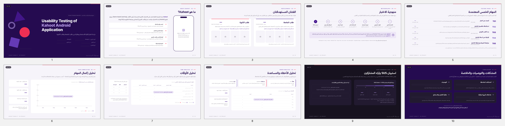
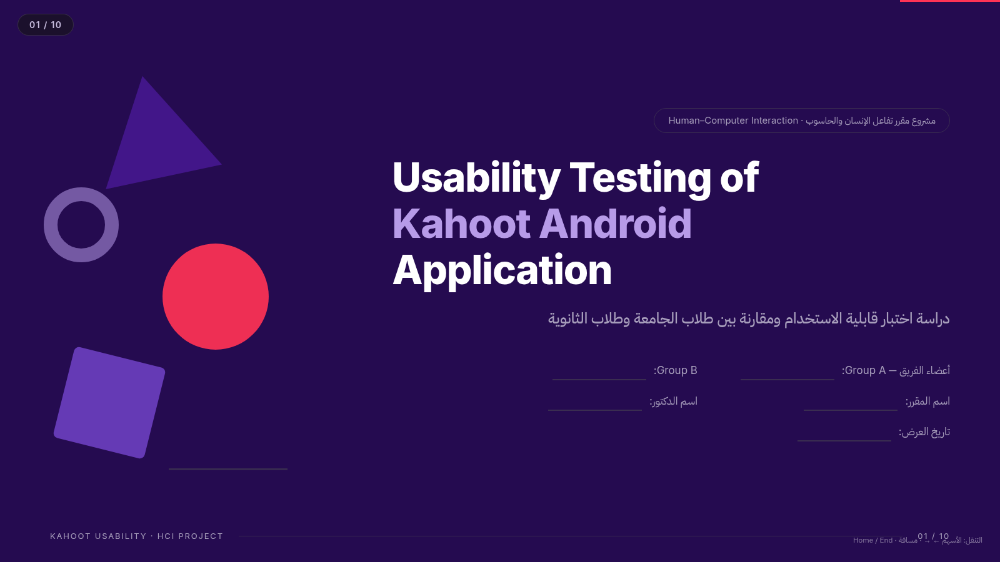
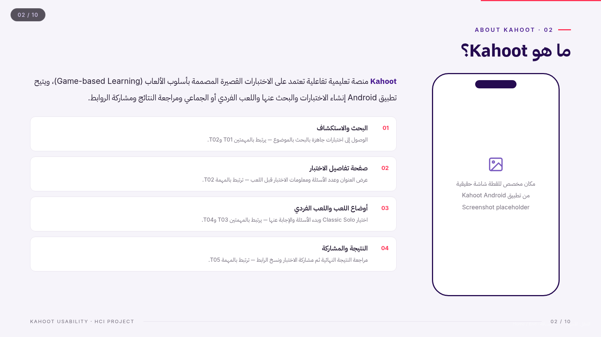
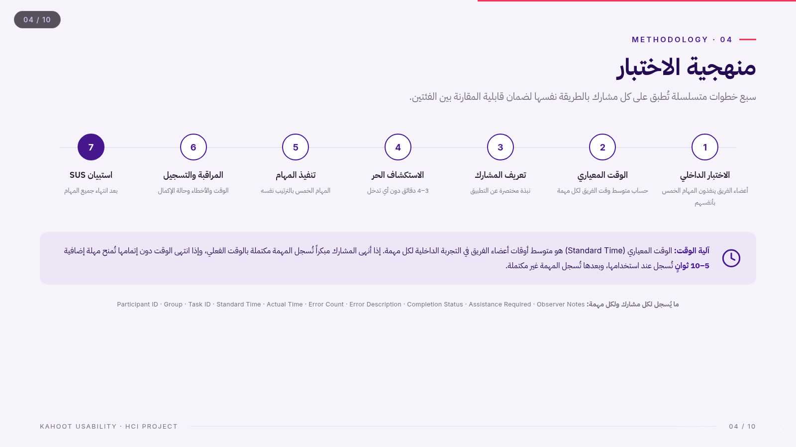
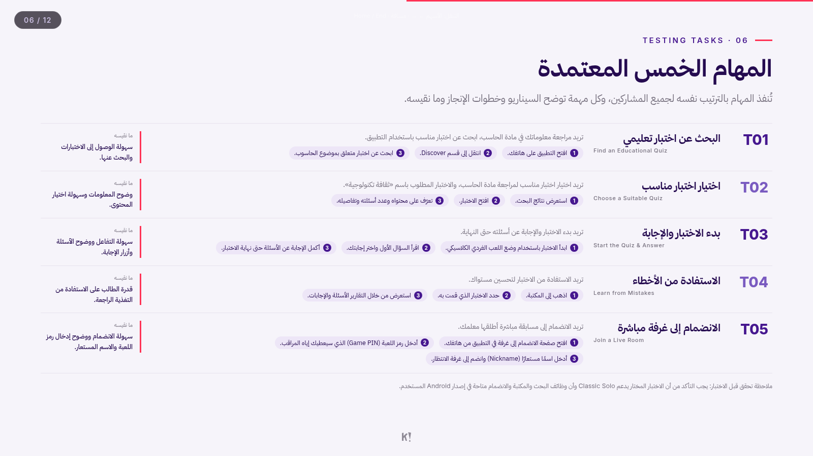
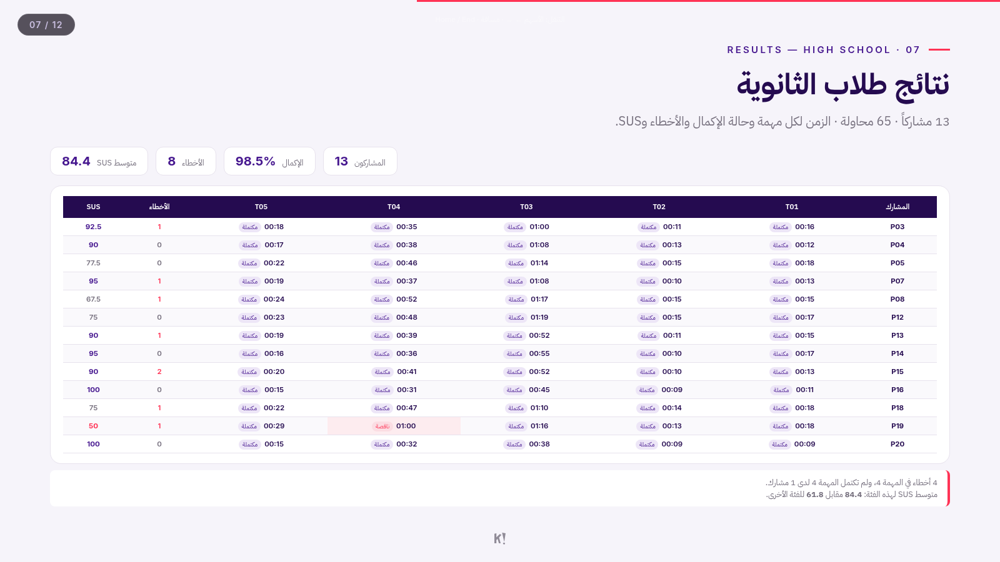
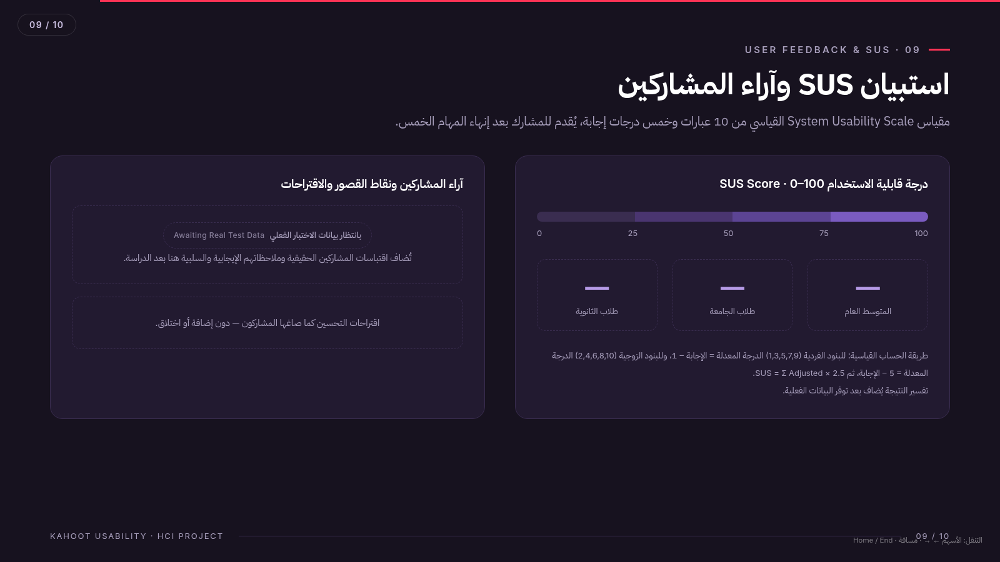
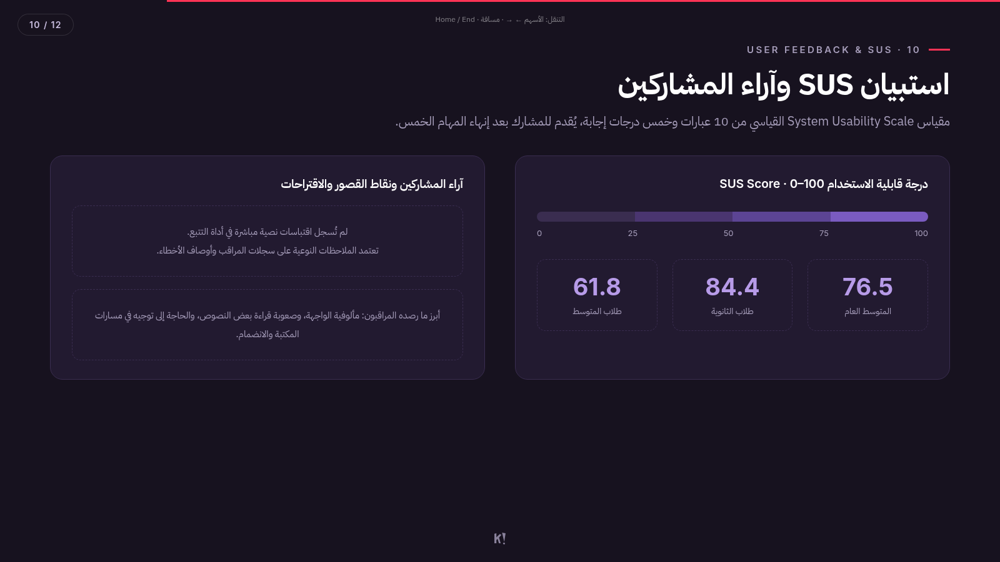
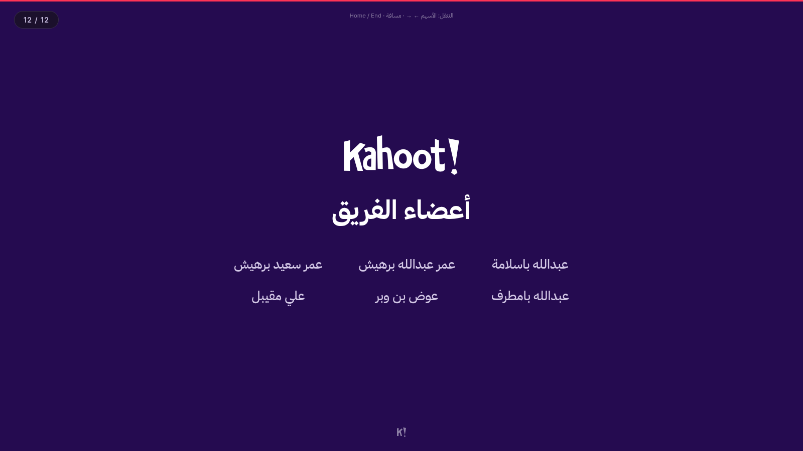

# Kahoot Android Usability Study

### Usability Testing of the Kahoot Android Application

An academic HCI presentation in **Arabic (RTL)** comparing the usability of the **Kahoot Android app** between **high-school** and **middle-school** students. Built as **two synchronized deliverables** — a fully offline HTML deck and a native, editable PowerPoint deck — from one data source.

<p align="center">
  
</p>

<p align="center">
  <sub>HTML deck — 12 slides · Kahoot × Editorial theme · Arabic RTL</sub>
</p>

---

## At a glance

| | |
|---|---|
| **Study** | Usability testing of Kahoot on Android |
| **Groups** | 13 high-school students · 7 middle-school students |
| **Data collected** | 20 participants · 100 task attempts · 20 SUS responses |
| **Completion** | 98 / 100 attempts completed |
| **SUS score** | **76.5 / 100** overall |
| **Deck format** | 12 slides · 16:9 · Arabic RTL |
| **Outputs** | Standalone HTML · native PPTX |
| **Status** | Final HTML + PPTX · comparison assets included |

---

## What this presentation is

The deck reports a complete usability study of the Kahoot Android application. It is not a template: every number, table, chart, and conclusion is derived from the study data in `data/`.

The presentation covers:

- the application and its main flows;
- the two participant groups;
- the five testing tasks and what each task measures;
- per-participant results for both groups;
- completion, time, error, assistance, and SUS analysis;
- observed problems, recommendations, and a final comparison.

---

## The 12 slides

| # | Slide | Content |
|---|---|---|
| 01 | **Cover** | Arabic title, Kahoot wordmark, study subtitle |
| 02 | **Inside the App** | Five real Android screenshots: home, discover, join, create, library |
| 03 | **About the App** | What Kahoot is + four core app capabilities |
| 04 | **Participants** | High-school vs middle-school cards with age, completion, and SUS |
| 05 | **Methodology** | Seven-step protocol + timing and timeout rules |
| 06 | **Testing Tasks** | Five tasks with scenario, step-by-step actions, and measured aspect |
| 07 | **Results — High School** | Time, completion, errors, and SUS for all 13 participants |
| 08 | **Results — Middle School** | Time, completion, errors, and SUS for all 7 participants |
| 09 | **Analysis Dashboard** | Unified completion, time, error, and key-findings view |
| 10 | **SUS & Feedback** | SUS scores and qualitative observations |
| 11 | **Problems & Conclusion** | Observed problems, recommendations, and group comparison |
| 12 | **Team** | Project team credits |

---

## Selected slides — HTML version

<table>
<tr>
<td width="50%">
  
  <br><sub><b>01 · Cover</b> — Arabic title and Kahoot identity</sub>
</td>
<td width="50%">
  
  <br><sub><b>02 · Inside the App</b> — real Android screenshots</sub>
</td>
</tr>
<tr>
<td width="50%">
  
  <br><sub><b>04 · Participants</b> — high-school vs middle-school</sub>
</td>
<td width="50%">
  
  <br><sub><b>06 · Testing Tasks</b> — scenario, steps, and measures</sub>
</td>
</tr>
<tr>
<td width="50%">
  
  <br><sub><b>07 · Results</b> — per-participant result table</sub>
</td>
<td width="50%">
  
  <br><sub><b>09 · Analysis</b> — completion, time, and errors</sub>
</td>
</tr>
<tr>
<td width="50%">
  
  <br><sub><b>10 · SUS</b> — usability score and observations</sub>
</td>
<td width="50%">
  
  <br><sub><b>12 · Team</b> — project credits</sub>
</td>
</tr>
</table>

---

## Results snapshot

| Metric | High School | Middle School |
|---|---:|---:|
| Participants | 13 | 7 |
| Age range | 15–18 | 12–14 |
| Average age | 16.2 | 13.3 |
| Completion rate | 98.5% | 97.1% |
| Completed / incomplete | 64 / 1 | 34 / 1 |
| Total errors | 8 | 14 |
| Assistance requests | 8 | 11 |
| SUS score | **84.4** | **61.8** |

**Overall:** 98 / 100 attempts completed · SUS **76.5**.

The most frequent issue was a wrong path during search/quiz selection (**9 cases**), followed by difficulty finding the library/reports section (**9 cases across both groups**).

---

## Final deliverables

| File | Description |
|---|---|
| [`final/kahoot-usability-presentation-final.html`](final/kahoot-usability-presentation-final.html) | Final standalone HTML deck (works offline) |
| [`final/kahoot-usability-presentation-final.pptx`](final/kahoot-usability-presentation-final.pptx) | Final native PowerPoint deck |
| [`comparison/comparison-montage.png`](comparison/comparison-montage.png) | HTML vs PPTX comparison sheet, all 12 slides |
| [`comparison/side-by-side/`](comparison/side-by-side/) | One comparison image per slide |
| [`comparison/README.md`](comparison/README.md) | Comparison notes and corrections |

The HTML deck is the design source of truth. The PowerPoint was corrected against it and verified slide-by-slide.

---

## Project structure

```text
.
├── final/                               # Final HTML + PPTX deliverables
├── comparison/                          # HTML vs PPTX screenshots and report
├── data/                                # Study data (single source of truth)
│   ├── participants.json
│   ├── tasks.json
│   ├── observations.json
│   ├── sus-responses.json
│   └── feedback.json
├── src/
│   ├── design/tokens.mjs                # Colors, fonts, dimensions
│   ├── content/slides-html.mjs          # HTML slide content and layout
│   ├── styles/presentation.css          # HTML design system
│   ├── scripts/presentation.js          # Navigation and scaling
│   ├── template.html                    # Standalone HTML shell
│   └── data/metrics.json                # Generated metrics
├── scripts/
│   ├── compute-metrics.mjs              # Study metrics + SUS calculation
│   ├── build-html.mjs                   # Offline HTML build
│   ├── build-pptx.mjs                   # Native PPTX build
│   ├── qa-html.mjs                      # Browser QA, offline checks
│   └── *.py                             # Render / overflow / font tools
├── assets/
│   ├── fonts/                           # Thmanyah Sans · IBM Plex Sans Arabic · Inter
│   ├── logos/                           # Kahoot wordmark and icon
│   └── screenshots/                     # Real Android app screenshots
├── previews/                            # Slide renders and montages
└── .tools/ + .venv/                     # Portable LibreOffice + Python venv (ignored)
```

---

## Data pipeline

```text
data/*.json
    │
    ▼
scripts/compute-metrics.mjs
    │
    ├── completion rates · average times · errors · assistance
    ├── per-participant results
    ├── top error types
    └── SUS scores
    │
    ▼
src/data/metrics.json
    │
    ├── scripts/build-html.mjs ──► final HTML
    └── scripts/build-pptx.mjs ──► final PPTX
```

All figures are computed from the study data. No values are hard-coded into the slides.

---

## Build & QA

```bash
pnpm install          # once
pnpm build            # compute metrics + HTML + PPTX
pnpm build:html       # HTML only
pnpm build:pptx       # PPTX only

node scripts/qa-html.mjs
```

Validation performed:

- HTML: 12 slides, RTL navigation, embedded fonts, zero overflow, zero console errors, fully offline.
- PPTX: 12 slides, native editable tables/charts/text, no overflow, no missing or substituted fonts.
- Comparison: one side-by-side screenshot per slide.

---

## Design system

| Element | Choice |
|---|---|
| Theme | Kahoot × Editorial |
| Primary | `#46178F` |
| Deep purple | `#250B50` |
| Accent | `#FF3355` |
| Light background | `#F6F4FA` |
| Arabic headings | Thmanyah Sans |
| Arabic body | IBM Plex Sans Arabic |
| Latin / numbers | Inter |
| Layout | 16:9 · RTL |

---

## Notes

- App screenshots are real captures from the Android app used in the study.
- No participant photos are included.
- Standard task times were not recorded in the tracker, so the standard-time column is intentionally left blank in the time analysis.
- The comparison report documents the only intentional PPTX adaptation: task steps use native numbered lines instead of HTML chips, while content and order remain identical.
